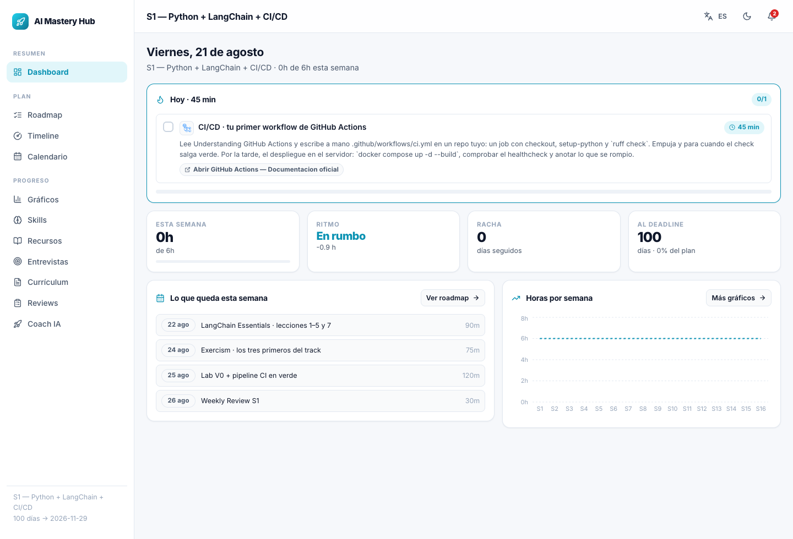
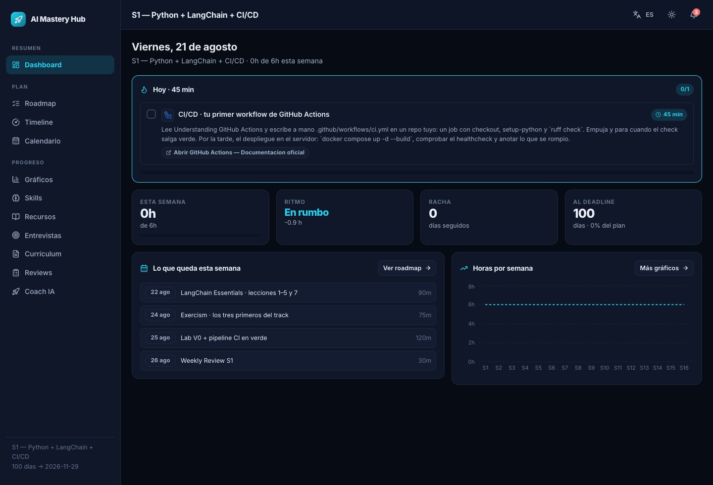
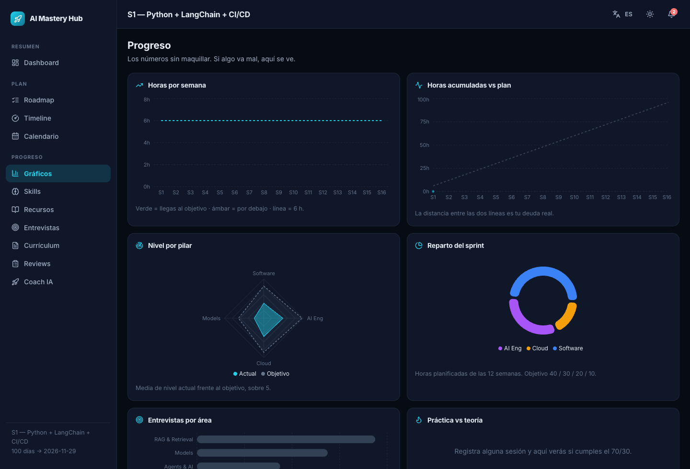
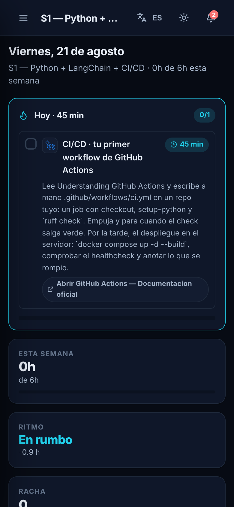
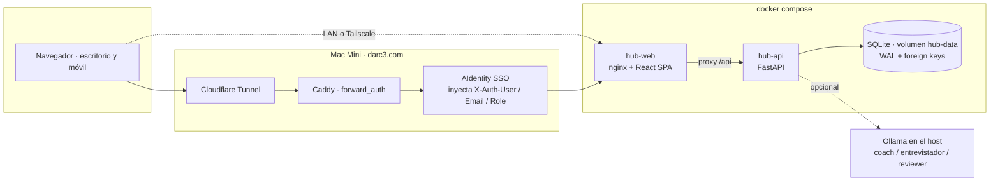
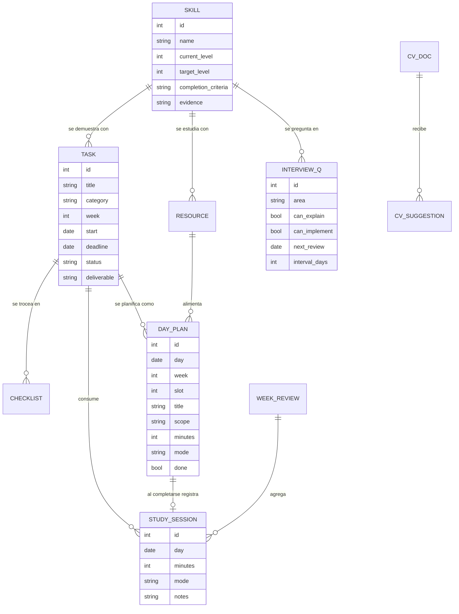
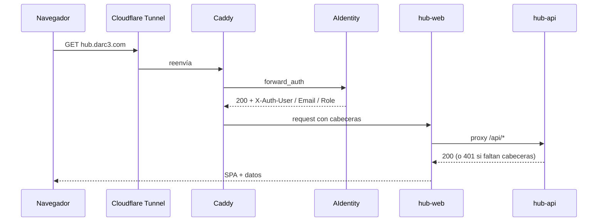
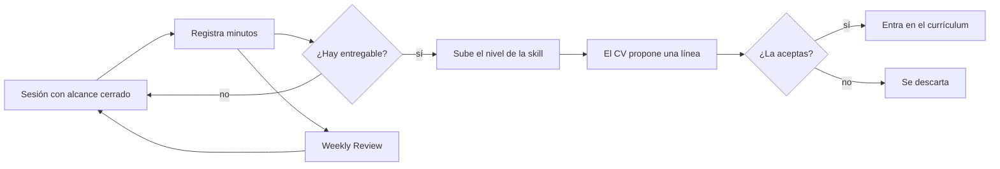

<div align="center">

# AI Mastery Hub

**El sistema operativo de mi carrera técnica como AI Engineer.**
Qué toca hoy, cuánto llevo de verdad, qué skills flojean y un currículum que solo crece con evidencia.


</div>

---

## Por qué existe

No es un gestor de tareas ni una lista de cursos. Es la herramienta de uso diario del
**AI Engineer Mastery Roadmap 2026**: 12 semanas de sprint (21 ago → 29 nov) más una fase
de modelos hasta el 31 de diciembre, a **6 h por semana**, con un día libre obligatorio.

Tres reglas que la aplicación hace cumplir por diseño:

| Regla | Cómo la aplica la app |
|---|---|
| **La unidad de trabajo es la sesión, no la tarea** | 95 sesiones concretas repartidas por día, cada una con su alcance exacto y dónde parar. "Aprender RAG" no dice qué hacer un martes; "Módulo 2, primera mitad, hasta terminar BM25" sí |
| **Evidencia, no cursos terminados** | Cada skill tiene su `Completion Criteria`. El nivel sube por lo que construyes, y solo entonces el CV propone una línea nueva |
| **Consistencia, no burnout** | 6 h/semana repartidas en 45/60/45/60/120 min + review. Si registras 7 días seguidos, la app te avisa de que descanses |

<div align="center">


</div>

---

## Qué hace

| Área | Detalle |
|---|---|
| **Dashboard** | Abre con la sesión de hoy y su alcance exacto. Debajo: horas de la semana, ritmo, racha, días al deadline y lo que queda de semana |
| **Plan diario** | 95 sesiones sobre el calendario real. Marcar una sesión registra sus minutos automáticamente |
| **Roadmap** | Ordenado por semanas, S1 primero, con el plan día a día dentro de cada una. Pestañas aparte para diciembre y para lo opcional |
| **Gráficos** | Horas por semana, acumulado vs plan, radar de nivel por pilar, donut de reparto, entrevistas por área y práctica vs teoría |
| **Timeline** | Gantt de agosto a diciembre con línea de "hoy" |
| **Calendario** | Mes navegable; al pulsar un día salen sus sesiones |
| **Skills** | 30 competencias con descripción, por qué importa, criterio de completion, nivel 0–5, evidencia y logo oficial |
| **Recursos** | 23 recursos verificados con logo, precio, horas reales y veredicto de por qué entra o se descarta |
| **Entrevistas** | 60 preguntas con doble check (*sé explicarlo* / *sé implementarlo*) y repetición espaciada |
| **Currículum** | CV vivo en markdown. Propone líneas cuando hay evidencia real; nada entra sin que lo aceptes |
| **Reviews** | Una entrada por semana con horas reales vs objetivo |
| **Coach IA** | Ollama local en tres roles: coach, entrevistador y code reviewer. Nunca escribe la solución |
| **Notificaciones** | Deadlines, atrasos, ritmo, review pendiente, hitos de racha y aviso de descanso |

Todo en **español e inglés**, con **tema claro/oscuro** y **responsive** para usarla desde el móvil.

<div align="center">


</div>

---

## Arquitectura



- **hub-web** sirve el build estático y hace de proxy de `/api` hacia `hub-api`, así que el
  navegador solo habla con un origen y no hay CORS en producción.
- **hub-api** no se expone al exterior: solo es alcanzable dentro de la red de compose.
- Detrás del portal, la API **exige** las cabeceras `X-Auth-*` que inyecta AIdentity.

### Modelo de datos



> **Una sola fuente de verdad para las horas: `study_sessions`.** Ritmo, racha, gráficos y
> reviews se derivan de ahí. Ninguna pantalla guarda su propio contador.

### El calendario del sprint


---

## Stack

| Capa | Tecnología | Por qué |
|:--|:--|:--|
|  **API** | FastAPI + Pydantic v2 | Contrato tipado y `/docs` gratis |
|  **ORM** | SQLAlchemy 2.0 | Estilo `select()` moderno, sin *legacy Query* |
|  **DB** | SQLite con WAL | Un solo usuario. Postgres sería sobreingeniería |
|  **UI** | React 19 + react-router 7 | — |
|  **Build** | Vite 6 + TypeScript strict | — |
| **Estado** | Zustand 5 con `persist` | Tema e idioma sobreviven al reload |
| **Gráficos** | Recharts 3 | Composable y sin canvas |
|  **Estilos** | CSS propio con variables | **Sin Tailwind**, por decisión |
|  **Logos** | simple-icons + lucide-react | SVG de una ruta y sin fondo; lucide para los conceptos abstractos |
|  **Runtime** | Docker Compose multi-stage | — |
|  **Servidor** | nginx alpine | Sirve el SPA y proxya `/api` |
|  **LLM** | Ollama en el host | Local, sin coste y sin salir de casa |

---

## Arranque

### Docker (lo normal)

```bash
cp .env.example .env
docker compose up -d --build
```

Abre **http://localhost:5183**. Los datos persisten en el volumen `hub-data`.

### Desarrollo local

Requiere Python 3.12+ y Node 20+.

```bash
# Backend
cd backend
python3 -m venv .venv
./.venv/bin/pip install -r requirements.txt
./.venv/bin/uvicorn app.main:app --reload --port 8183

# Frontend (otra terminal)
cd frontend
npm install
npm run dev
```

| Servicio | URL |
|---|---|
| Frontend | http://localhost:5183 |
| API | http://localhost:8183/api/health |
| OpenAPI | http://localhost:8183/docs |

La base de datos se crea sola en `backend/data/hub.db` y se siembra en el primer arranque.
El seed es **idempotente**: reiniciar no duplica nada.

### Despliegue en el Mac Mini (portal darc3)



```bash
docker compose -f docker-compose.yml -f docker-compose.portal.yml up -d --build
/add-to-portal
```

El override conecta ambos contenedores a la red `auth-proxy_default` y activa
`REQUIRE_PORTAL_AUTH=true`. El último paso, dar de alta el public hostname `hub.darc3.com`
en Cloudflare Zero Trust, **es manual**.

---

## Configuración

Todo por variables de entorno, ver `.env.example`:

| Variable | Por defecto | Para qué |
|---|---|---|
| `WEB_PORT` | `5183` | Puerto expuesto del frontend |
| `REQUIRE_PORTAL_AUTH` | `false` | `true` detrás del auth-proxy |
| `SPRINT_START` | `2026-08-21` | Inicio del sprint |
| `CORE_DEADLINE` | `2026-11-29` | Cierre del núcleo (con la pausa de Tailandia + Vietnam, 1–18 oct) |
| `FINAL_DEADLINE` | `2026-12-31` | Fin de la fase de modelos |
| `WEEKLY_TARGET_HOURS` | `6` | Objetivo semanal |
| `COACH_ENABLED` | `true` | Activa el coach |
| `OLLAMA_URL` | `http://host.docker.internal:11434` | Ollama del host |
| `OLLAMA_MODEL` | `qwen2.5:7b` | Modelo del coach |

---

## API

Todo bajo el prefijo `/api`. Lo más usado:

| Método | Ruta | Qué hace |
|---|---|---|
| `GET` | `/dashboard` | El agregado que pinta la portada: hoy, ritmo, racha, horas por semana |
| `GET` | `/days?start=&end=` | Sesiones del rango |
| `POST` | `/days/{id}/complete` | Marca la sesión **y registra sus minutos**, en una sola llamada |
| `GET · POST` | `/sessions` | Horas registradas a mano |
| `GET` | `/sessions/heatmap` | Actividad por día |
| `GET · PATCH` | `/skills` · `/skills/{id}` | Nivel y evidencia; el estado se deriva del nivel |
| `GET · PATCH` | `/tasks` · `/tasks/{id}` | Estado, foco del día, horas |
| `PATCH` | `/questions/{id}` | Doble check y reprogramación de la repetición espaciada |
| `GET · PUT` | `/cv` | CV vivo en markdown |
| `POST` | `/cv/suggestions/sync` | Busca evidencia nueva y propone líneas |
| `POST` | `/coach/chat` | Coach local, en modo entrenamiento |
| `POST` | `/notifications/refresh` | Reevalúa las 7 reglas |

Contrato completo en `/docs`.

---

## Metodología

Práctica deliberada (Ericsson) + *retrieval practice* + repetición espaciada.



**Repetición espaciada de las 60 preguntas**: si puedes explicarla *e* implementarla, el
intervalo se duplica; si fallas cualquiera de las dos, vuelve mañana y el intervalo se
reinicia a 1 día.

**Modos de trabajo**. En *PRODUCTION* la IA escribe código sin límite. En *TRAINING* —el
modo del coach de esta app— la IA explica, pregunta, revisa y hace de entrevistador, pero
**nunca** escribe la solución. La dinámica es *yo pienso → yo escribo → la IA revisa*.

---

## Estructura

```
backend/app/
  main.py            arranque, CORS, routers, seed en el lifespan
  config.py          settings por entorno
  models.py          15 tablas
  schemas.py         contrato de la API
  dependencies.py    auth por cabeceras del portal
  seed_plan.py       17 semanas, 74 tareas, 60 preguntas
  seed_days.py       95 sesiones diarias con su alcance
  seed_data.py       30 skills y 23 recursos
  seed.py            siembra idempotente
  routers/           skills · tasks · tracking · growth
  services/          progress · cv_builder · notifier · coach
frontend/src/
  pages/             Dashboard · Roadmap · Plan · Progress · Skills · Resources ·
                     Interview · CV · Reviews · Coach
  components/        ui.tsx · TaskCard.tsx · DaySession.tsx · charts.tsx
  lib/               api.ts · logos.tsx
  store/             zustand (prefs + datos)
  i18n/              ES / EN
  styles/            tokens.css · global.css
docs/                capturas del README
```

---

## Currículum

En el primer arranque el CV se importa de la primera fuente que exista:

1. `/app/import/cv.md` (montado desde `backend/import/`)
2. `~/career-ops/cv.md`
3. Una plantilla vacía

> El CV real **no está en el repo** (`backend/import/cv.md` está en `.gitignore`). Deja ahí
> tu markdown antes del primer arranque y la app lo adopta.

A partir de ahí vive en la base de datos. La app propone líneas nuevas cuando una skill
llega a nivel 4+ o *Interview Ready*, o cuando completas una tarea con entregable.
**Nada entra en el CV sin que lo aceptes.**

---

## Notas y gotchas

- **La distribución por pilar se calcula solo sobre el sprint de 12 semanas**, que es donde
  aplica el reparto 40 / 30 / 20 / 10. Diciembre es deliberadamente *Models* y desvirtuaría
  el dato; las tareas de relleno opcional tampoco cuentan.
- **`seed_days` corta si ya hay filas en `day_plans`.** Para resembrar el plan diario hay que
  borrarlas primero y después reiniciar el contenedor.
- **nginx tiene que escuchar también en IPv6** (`listen [::]:80`). Dentro del contenedor
  `localhost` resuelve antes a `::1`, así que sin eso el healthcheck falla aunque la web
  responda perfectamente.
- **Recharts necesita colores reales, no `var(--accent)`.** Por eso existe `useChartTheme()`.
- **Python 3.14 todavía no tiene wheels de pydantic-core** en algunas versiones; la imagen usa
  `python:3.12-slim` para no compilar nada.
- El pipeline de CI de este repo **no está hecho a propósito**: escribirlo a mano es el
  ejercicio de la semana 1 del roadmap.
- Si no registras horas, ni el ritmo ni la racha ni los gráficos significan nada. Empieza
  marcando la sesión del día.
