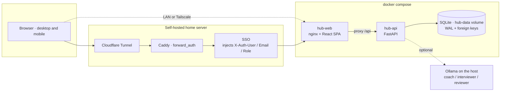
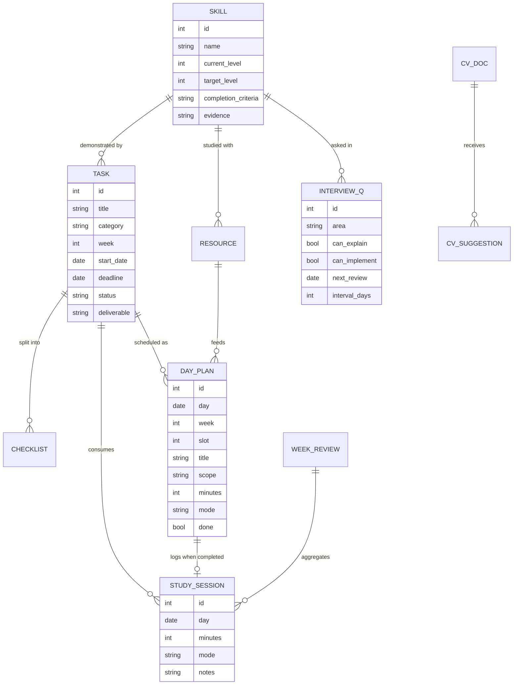
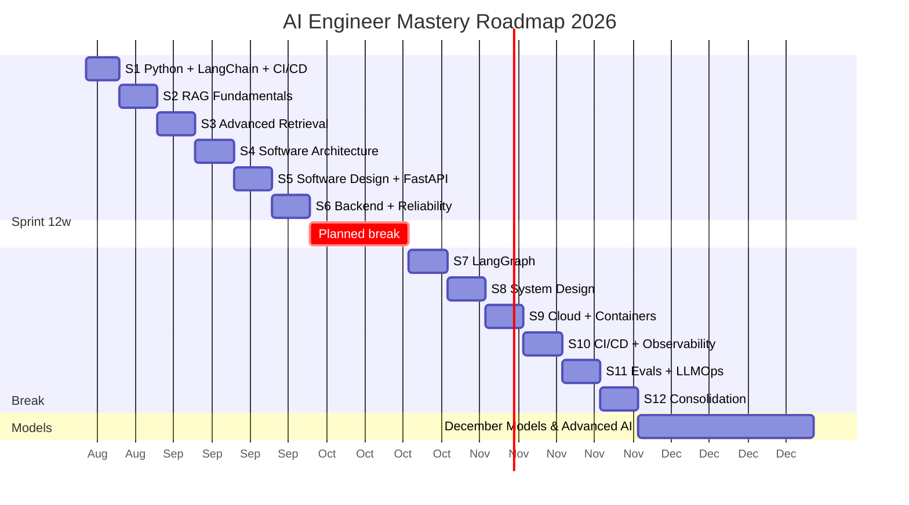
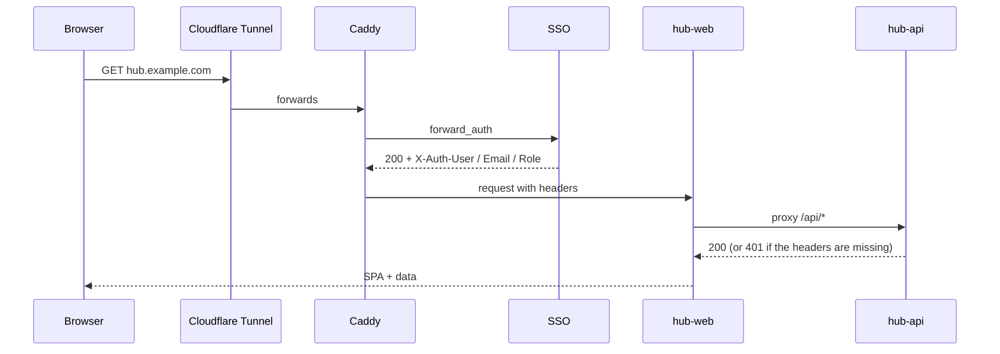
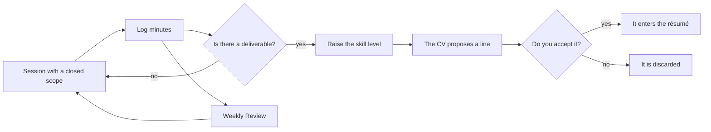

<div align="center">


**The operating system for my technical career as an AI Engineer.**
What is due today, how much progress is real, which skills are weak, and a résumé that only grows with evidence.


</div>

---

## What this demonstrates

A self-hosted learning system for an AI engineering roadmap. The UI is available in **Spanish and English**.

- **FastAPI + SQLAlchemy 2 typed API.** Pydantic v2 schemas, `response_model` contracts, and SQLAlchemy 2 queries (`select()`, `Mapped` relationships).
- **React 19 + TypeScript strict.** Vite 6, `strict` plus unused-symbol checks, Zustand for theme and language.
- **Docker multi-stage.** The frontend image builds with Node and serves the SPA from nginx. Compose runs the API and the web container.
- **SSO forward-auth.** Behind the proxy, the API requires the `X-Auth-*` headers the proxy injects. Local development stays a single-user app with no login screen.
- **Local LLM coach via Ollama.** Three roles — coach, interviewer, and code reviewer — that explain, question, and review. The training prompt refuses to write the solution.
- **Spaced repetition.** When a question is marked both explainable and implementable, the review interval doubles with a floor of 3 days. If either check fails, the interval resets to 1 day.

---

## Why it exists

This is not a task manager or a course list. It is the daily tool for the
**AI Engineer Mastery Roadmap 2026**: a 12-week sprint (21 Aug → 29 Nov) plus a
models phase through 31 December, at **6 hours per week**, with one mandatory day off.

Three rules the application enforces by design:

| Rule | How the app applies it |
|---|---|
| **The unit of work is the session, not the task** | 95 concrete sessions laid out by day, each with an exact scope and a stopping point. "Learn RAG" does not say what to do on a Tuesday; "Module 2, first half, stop when BM25 is done" does |
| **Evidence, not finished courses** | Every skill has `Completion Criteria`. The level rises from what you build, and only then does the résumé propose a new line |
| **Consistency, not burnout** | 6 h/week split into 45/60/45/60/120 min plus a review. If you log 7 days in a row, the app tells you to rest |

<div align="center">


</div>

---

## What it does

| Area | Detail |
|---|---|
| **Dashboard** | Opens on today's session and its exact scope. Below: hours this week, pace, streak, days to the deadline, and what is left in the week |
| **Daily plan** | 95 sessions on the real calendar. Completing a session logs its minutes automatically |
| **Roadmap** | Ordered by week, S1 first, with the day-by-day plan inside each week. Separate tabs for December and for optional work |
| **Charts** | Hours per week, cumulative vs plan, skill-level radar by pillar, distribution donut, interviews by area, and practice vs theory |
| **Timeline** | Gantt from August to December with a "today" line |
| **Calendar** | Navigable month; selecting a day shows its sessions |
| **Skills** | 31 skills with a description, why it matters, completion criteria, level 0–5, evidence, and an official logo |
| **Resources** | 25 checked resources with logo, price, real hours, and a verdict on why each one is in or out |
| **Interviews** | 60 questions with a double check (*I can explain it* / *I can implement it*) and spaced repetition |
| **Résumé** | Living CV in markdown. Proposes lines when there is real evidence; nothing is added until you accept it |
| **Reviews** | One entry per week with actual hours vs the target |
| **AI coach** | Local Ollama in three roles: coach, interviewer, and code reviewer. It never writes the solution |
| **Notifications** | Deadlines, overdue work, pace, a pending review, streak milestones, and a rest reminder |

The interface is in **Spanish and English**, with a **light/dark theme** and a **responsive** layout for mobile.

<div align="center">


</div>

---

## Architecture

The public deployment is my self-hosted home server behind Cloudflare Tunnel + Caddy + SSO.



- **hub-web** serves the static build and proxies `/api` to `hub-api`, so the
  browser talks to a single origin and production does not need CORS.
- **hub-api** is not published on the host: it is only reachable on the Compose network.
- Behind the portal, the API **requires** the `X-Auth-*` headers injected by the SSO proxy.
- Local Compose uses SQLite. The portal override points the API at Postgres and does not store the password in git.

### Data model



> **One source of truth for hours: `study_sessions`.** Pace, streak, charts, and
> reviews are all derived from it. No screen keeps its own counter.

### Sprint calendar



---

## Stack

| Layer | Technology | Why |
|:--|:--|:--|
|  **API** | FastAPI + Pydantic v2 | Typed contract and free `/docs` |
|  **ORM** | SQLAlchemy 2.0 | Modern `select()` style, no legacy Query |
|  **DB** | SQLite with WAL | Local single-user default. The portal override uses Postgres |
|  **UI** | React 19 + react-router 7 | — |
|  **Build** | Vite 6 + TypeScript strict | — |
| **State** | Zustand 5 with `persist` | Theme and language survive reload |
| **Charts** | Recharts 3 | Composable, no canvas |
|  **Styles** | Custom CSS with variables | **No Tailwind**, on purpose |
|  **Logos** | simple-icons + lucide-react | Single-path SVG, no background; lucide for abstract concepts |
|  **Runtime** | Docker Compose, multi-stage frontend image | — |
|  **Server** | nginx alpine | Serves the SPA and proxies `/api` |
|  **LLM** | Ollama on the host | Local, no per-token cost, no external API |

---

## Getting started

### Docker (the usual path)

```bash
cp .env.example .env
docker compose up -d --build
```

Open **http://localhost:5183**. Data persists in the `hub-data` volume.

### Local development

Requires Python 3.12+ and Node 20+.

```bash
# Backend
cd backend
python3 -m venv .venv
./.venv/bin/pip install -r requirements.txt
./.venv/bin/uvicorn app.main:app --reload --port 8183

# Frontend (another terminal)
cd frontend
npm install
npm run dev
```

| Service | URL |
|---|---|
| Frontend | http://localhost:5183 |
| API | http://localhost:8183/api/health |
| OpenAPI | http://localhost:8183/docs |

The database is created at `backend/data/hub.db` and seeded on first boot.
The seed is **idempotent**: restarting does not duplicate rows.

### Deploy on the self-hosted home server

My self-hosted home server behind Cloudflare Tunnel + Caddy + SSO.



```bash
cp .env.example .env   # if it does not exist yet
# Set POSTGRES_PASSWORD in .env to the rotated password. Do not commit it.
docker compose -f docker-compose.yml -f docker-compose.portal.yml up -d --build
```

The override attaches both containers to the proxy network and sets
`REQUIRE_PORTAL_AUTH=true`. The last step, registering the public hostname
(`hub.example.com` in the diagram) in Cloudflare Zero Trust, **is manual**.

---

## Configuration

Everything is configured with environment variables. See `.env.example`. Copy that
file to `.env` (it is in `.gitignore` and must not be committed). Secrets do not
belong in versioned files. On GitHub, non-sensitive values can be repository
variables; `OLLAMA_URL` (it names internal infrastructure) and `POSTGRES_PASSWORD`
(the rotated Postgres password) are **secrets**. The deploy workflow reads
`secrets.POSTGRES_PASSWORD`, and `docker-compose.portal.yml` interpolates it into
`DATABASE_URL`.

```bash
gh variable list --repo diegoperezg7/ai-learn
gh secret list   --repo diegoperezg7/ai-learn
```


| Variable | Default | Purpose |
|---|---|---|
| `POSTGRES_PASSWORD` | placeholder in `.env.example`; required on the portal | Postgres password for the portal database. Not stored in git |
| `DATABASE_URL` | `sqlite:////app/data/hub.db` in local Compose | URL the API receives. On the portal it is built with `POSTGRES_PASSWORD` |
| `DATABASE_SCHEMA` | `public` (local) / `ai_learn` (portal) | Database schema |
| `WEB_PORT` | `5183` | Published frontend port |
| `REQUIRE_PORTAL_AUTH` | `false` | `true` behind the auth proxy |
| `SPRINT_START` | `2026-08-21` | Sprint start |
| `CORE_DEADLINE` | `2026-11-29` | End of the core sprint, including a planned break (1–18 Oct) |
| `FINAL_DEADLINE` | `2026-12-31` | End of the models phase |
| `WEEKLY_TARGET_HOURS` | `6` | Weekly target |
| `COACH_ENABLED` | `true` | Turns the coach on |
| `OLLAMA_URL` | `http://host.docker.internal:11434` | Ollama on the host |
| `OLLAMA_MODEL` | `qwen2.5:7b` | Coach model |

---

## API

Everything is under the `/api` prefix. The routes used most often:

| Method | Path | What it does |
|---|---|---|
| `GET` | `/dashboard` | The aggregate that paints the home screen: today, pace, streak, hours per week |
| `GET` | `/days?start=&end=` | Sessions in the range |
| `POST` | `/days/{id}/complete` | Marks the session **and logs its minutes**, in one call |
| `GET · POST` | `/sessions` | Hours logged by hand |
| `GET` | `/sessions/heatmap` | Activity by day |
| `GET · PATCH` | `/skills` · `/skills/{id}` | Level and evidence; status is derived from the level |
| `GET · PATCH` | `/tasks` · `/tasks/{id}` | Status, today's focus, hours |
| `PATCH` | `/questions/{id}` | Double check and rescheduling of spaced repetition |
| `GET · PUT` | `/cv` | Living CV in markdown |
| `POST` | `/cv/suggestions/sync` | Looks for new evidence and proposes lines |
| `POST` | `/coach/chat` | Local coach, in training mode |
| `POST` | `/notifications/refresh` | Re-evaluates the 7 rules |

Full contract at `/docs`.

---

## Method

Deliberate practice (Ericsson) + retrieval practice + spaced repetition.



**Spaced repetition for the 60 questions**: if you can explain it *and* implement it,
the interval doubles (floor of 3 days). If either check fails, it is due tomorrow and
the interval resets to 1 day.

**Training mode.** The coach explains, asks questions, reviews and interviews, but it
**never** writes the solution. The loop is *I think → I write → the coach reviews*.

---

## Layout

```
backend/app/
  main.py            startup, CORS, routers, seed in the lifespan
  config.py          settings from the environment
  models.py          SQLAlchemy models
  schemas.py         API contract
  dependencies.py    auth from the portal headers
  seed_plan.py       weeks, tasks, and interview questions
  seed_days.py       daily sessions and their scope
  seed_data.py       skills and resources
  seed.py            idempotent seed
  routers/           skills · tasks · tracking · growth
  services/          progress · cv_builder · notifier · coach
frontend/src/
  pages/             Dashboard · Roadmap · Plan · Progress · Skills · Resources ·
                     Interview · CV · Reviews · Coach
  components/        ui.tsx · TaskCard.tsx · DaySession.tsx · charts.tsx
  lib/               api.ts · logos.tsx
  store/             zustand (prefs + data)
  i18n/              ES / EN
  styles/            tokens.css · global.css
docs/                README screenshots
```

---

## Résumé

On first boot the CV is imported from the first source that exists:

1. `/app/import/cv.md` (mounted from `backend/import/`)
2. `backend/import/cv.md` when the API runs outside Docker
3. A starter template

> The real CV **is not in the repo** (`backend/import/cv.md` is in `.gitignore`). Put
> your markdown there before the first boot and the app adopts it.

From then on it lives in the database. The app proposes new lines when a skill
reaches level 4+ or *Interview Ready*, or when you complete a task that has a deliverable.
**Nothing enters the CV until you accept it.**

---

## Notes and gotchas

- **Pillar distribution is calculated only on the 12-week sprint**, which is where
  the 40 / 30 / 20 / 10 split applies. December is deliberately *Models* and would
  distort the figure; optional filler tasks do not count either.
- **`seed_days` stops if `day_plans` already has rows.** To reseed the daily plan,
  delete those rows first and then restart the container.
- **nginx must also listen on IPv6** (`listen [::]:80`). Inside the container
  `localhost` resolves to `::1` first, so without that the healthcheck fails even
  when the site responds fine.
- **Recharts needs real colors, not `var(--accent)`.** That is why `useChartTheme()` exists.
- **Python 3.14 still has no pydantic-core wheels** on some versions; the image uses
  `python:3.12-slim` so nothing has to be compiled.
- **CI validates pull requests on GitHub-hosted runners.** `npm ci`, the frontend
  build, and `docker compose config` run on `ubuntu-latest`. The production deploy
  stays on the self-hosted runner and only runs for this repository on `main`:
  on push, or on a manual dispatch started by the owner. Pull requests and forks
  never reach it.
- If you do not log hours, pace, streak, and charts mean nothing. Start by
  marking today's session.

---

## License

Copyright (c) 2026 Diego Pérez. All rights reserved.

Published for portfolio and evaluation purposes only. You may read the code to evaluate the author's work; copying, modifying, distributing or using it requires written permission. See [LICENSE](LICENSE).
